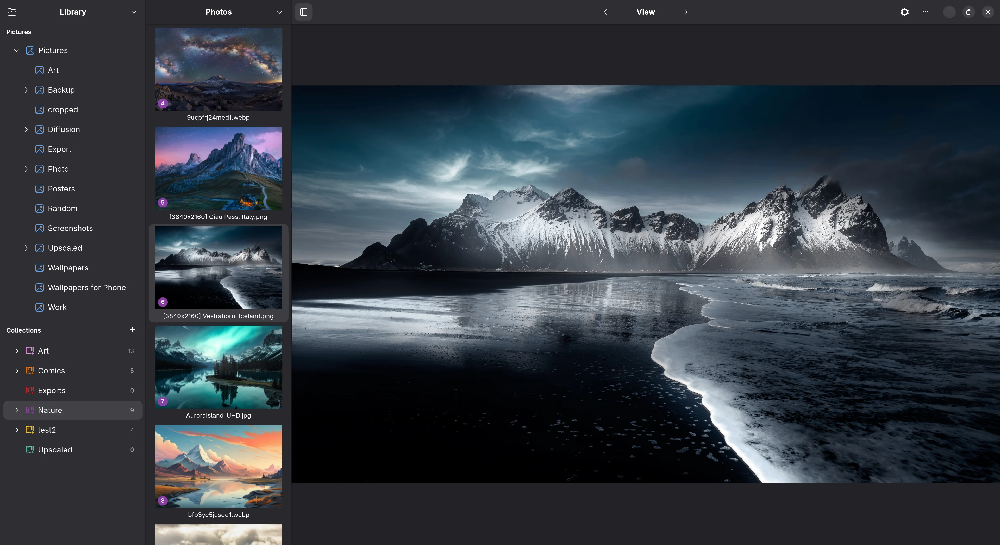

# Sharpr

A fast, private image library for Linux, for finding, curating, and preparing wallpaper-grade images from large, messy collections. Built with Rust, GTK4, and Libadwaita.



Sharpr is for people with thousands of downloaded images, generated artwork, and photos, whose file names are meaningless and whose metadata can't be trusted. You browse real folders, describe what you're looking for in plain words, and keep the good ones in hand-picked buckets. Everything runs on your own computer.

## What It Does

- **Browse folders quickly.** Choose one library folder; its subfolders appear in the sidebar. The filmstrip and viewer stay responsive in folders of thousands of images, with a wide scroll handle for jumping through them. Thumbnails load visible-first in the background, and very large images open without freezing.
- **Find images by describing them.** Type `woman on a sofa`, `dark mountain landscape`, or `watercolor`, and Sharpr ranks images by what they show, not by their names. It runs the EmbeddingGemma 2 model locally through [llama.cpp](https://github.com/ggml-org/llama.cpp).
- **Filter by typing.** Words such as `4k`, `below 4k`, `png`, `jxl`, `16:9`, `portrait`, or `landscape` become removable chips: `mountains 4k png 16:9` finds 4K PNG mountains in 16:9. Search covers the current folder or bucket, with a switch for the whole library.
- **Keep images in buckets.** Buckets are hand-picked groups, nested if you like, and they never move or copy your files. Ctrl+Shift+B adds to the last bucket again. Crop, export and Duplicate put each original and its copy in an Edits bucket, so you can compare them wherever the copy was saved. Rename and Move carry bucket membership and legacy tags to the new path. A bucket also remembers each image by its content, so it keeps it after the file is moved or renamed outside Sharpr.
- **Compare** two or more images, two at a time: side by side, a draggable split, or A/B flip, with zoom and pan locked together and a row of candidate thumbnails. Keep the better one with the arrow keys until the best is left; the survivors stay selected.
- **Survey** a selection in a grid and dismiss the ones you don't want, to narrow it down without touching any file.
- **Prepare wallpapers.** Crop a copy, or batch-export a selection as WebP (lossless by default, optionally fitted within a size such as 3840×2160) in the background. Every copy is a new, uniquely named file.
- **Clean up copies.** Find exact copies, and resized or converted copies of the same picture (crops and variants are left alone), keep the highest resolution, and move the rest to the trash after you confirm.
- **View** JPEG, PNG, WebP, JPEG XL, GIF, TIFF, and BMP, with zoom, fullscreen, and a corner readout that expands into file details and EXIF on hover. The large image has the same right-click menu as the filmstrip.

## Why It Works Well

- **Search that understands pictures.** In a blind test of 30 real queries across subjects, styles, moods, and people, 85–88% of the top 20 results were relevant, and 95% of the top 5. Each search takes about 15 ms. The status line under the search box says how strong the matches are and how much of the library is indexed, so "no good match" never passes for a real result.
- **Fast on a graphics card.** With a GPU, a library of 6,000 images is indexed in about 20 minutes, about 17 times faster than on the processor, and with the same results. Without one, indexing runs on the processor in the background at the lowest priority. Either way, it resumes where it stopped.
- **Private by design.** Sharpr makes no network connections. The model runs in a local process that only Sharpr can reach. Sharpr never downloads anything; you install the model files yourself.
- **Your files stay yours.** Sharpr never modifies, re-encodes, renames, or moves an original image on its own. Copies are new files that never overwrite anything, and deleting only moves files to the system trash, with Undo. Your folders remain the source of truth.
- **Your curation survives.** Bucket membership follows each image's content fingerprint, so reorganising folders in your file manager doesn't break your buckets. Files that can't be found are counted, never dropped.

## Requirements

- Linux with GTK 4.16+, Libadwaita 1.8+ and Pango 1.56+ (GNOME 50 or a current Fedora). The Flatpak targets the GNOME 50 runtime.
- For visual search: the EmbeddingGemma 2 GGUF files (Q8_0 model and multimodal projector) and a `llama-server` build. A Vulkan build of `llama-server` enables GPU indexing.
- A minimum window size of 1024 × 600.

## Building

### Native

On Fedora, install the build dependencies, then build and run:

```bash
sudo dnf install gtk4-devel libadwaita-devel pkg-config gcc
cd sharpr
glib-compile-schemas data/
GSETTINGS_SCHEMA_DIR=data cargo run --release
```

### Flatpak

```bash
cd sharpr/packaging
bash sync-flatpak-source.sh          # exports the committed tree at HEAD
flatpak-cargo-generator ../Cargo.lock -o cargo-sources.json
bash build-flatpak.sh                # builds with bounded memory, then installs
flatpak run io.github.hebbihebb.Sharpr
```

This needs the GNOME 50 SDK and the Rust stable SDK extension. The Flatpak builds its own `llama-server` from pinned source, a processor build and a Vulkan build for GPU indexing, and Sharpr always runs it offline. Commit before syncing: the build uses HEAD only.

## Setting Up Visual Search

Sharpr looks for the model in `~/.local/share/sharpr-models/embeddinggemma-2/`. The install script copies the files there and verifies each one:

```bash
python3 tools/install-visual-search-model.py \
    --models /path/to/gguf-files \
    --runtime /path/to/llama-server-cpu \
    --gpu-runtime /path/to/llama-server-vulkan   # optional
```

- `--models` holds `embeddinggemma-2-Q8_0.gguf` and `mmproj-embeddinggemma-2-Q8_0.gguf`.
- `--runtime` and `--gpu-runtime` hold a `llama-server` binary with its `lib*.so*` files, such as the processor and Vulkan builds from the llama.cpp releases.

Indexing then starts on its own. Main Menu → Library → Library Overview shows its progress; Preferences → Library → Use Graphics Card turns GPU indexing off. Until the model is installed, search matches file names.

## Keyboard Shortcuts

| Shortcut | Action |
| --- | --- |
| Start typing, or Ctrl+F | Search |
| Alt+← / Alt+→ | Previous / next image |
| Ctrl+B | Add the selection to a bucket |
| Ctrl+Shift+B | Add to the last bucket again |
| Ctrl+Shift+C | Compare the selection |
| Ctrl+Shift+S | Survey the selection |
| Ctrl+A | Select all images shown |
| Ctrl+E | Export the selection as WebP |
| Ctrl+I | Image info |
| Shift+F10 or Menu | Image menu: copies, Compare, file actions |
| Scroll / Ctrl+0 | Zoom at the pointer / fit the image |
| F2 | Rename |
| Delete | Move the selection to the trash |
| F9 | Toggle the library sidebar |
| Double-click or F11 | Fullscreen |
| Ctrl+? | All shortcuts |

## Where Your Data Lives

| What | Where |
| --- | --- |
| Library index, buckets, and fingerprints | `~/.local/share/sharpr/library-index.sqlite` |
| Visual search index (safe to delete; it rebuilds) | `~/.local/share/sharpr/visual-search.sqlite` |
| Model files | `~/.local/share/sharpr-models/` |
| Settings | GSettings, `io.github.hebbihebb.Sharpr` |
| Thumbnails and logs | `~/.cache/sharpr/` |

## License

GPL-3.0-or-later.
